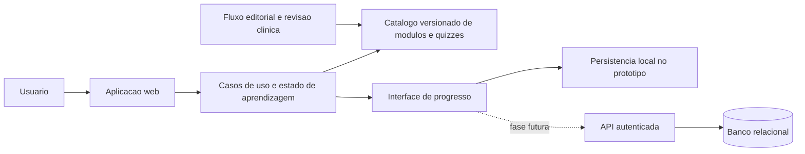

# Projeto Tecnico - Aplicativo Interativo de Situacoes Emergenciais

**Status:** proposta tecnica para o Pre-TCC  
**Documento de requisitos:** [PRD.md](PRD.md)  
**Interface de referencia:** [index.html](index.html)  
**Nome do produto:** Primeiro Passo (provisorio)  
**Data:** 13/10/2026

## 1. Objetivo

Descrever como evoluir o prototipo atual para uma aplicacao web educativa de primeiros socorros, mantendo o design aprovado: interface leve, colorida, minimalista e acolhedora, com ilustracao cartunesca discreta. O documento separa o prototipo academico da arquitetura recomendada para um MVP funcional, para evitar implementar infraestrutura antes de as regras de produto estarem definidas.

Este sistema e educativo. Nao deve realizar triagem, diagnostico ou orientar uma emergencia em andamento, nem apresentar quizzes como certificacao de habilidade pratica.

## 2. Estado atual e decisoes

O repositorio atual contem `index.html`, `PRD.md` e `README.md`. Nao ha framework, dependencias, backend ou configuracao de build. O HTML atual concentra estrutura, CSS e JavaScript em um unico arquivo. O progresso do quiz existe somente em memoria durante a sessao; recarregar a pagina reinicia os dados.

| Assunto | Decisao ou proposta |
| --- | --- |
| Produto | Aplicacao web educativa, inicialmente voltada a computador |
| Conexao | Requer internet; funcionamento offline nao faz parte do escopo |
| Conteudo inicial | Portugues do Brasil, com foco no contexto brasileiro |
| Publico | Pessoas interessadas a partir de 10 anos; adequacao de linguagem deve ser testada |
| Experiencia | Quizzes, progressao, missoes, conquistas e revisao |
| Protótipo do Pre-TCC | Frontend estatico, sem conta, backend ou conteudo clinico nao revisado |
| Interface | Design atual de `index.html`, com paleta colorida, superficies suaves e desenho cartunesco contido |
| Produto futuro | React + TypeScript + Vite e backend somente quando as regras de conta, sincronizacao e ranking forem aprovadas |

**Discrepancia a resolver no PRD:** a capa usa “a partir de 10 anos”, enquanto a secao de publico diz “mais de 10 anos”. O documento tecnico adota “a partir de 10 anos” como premissa provisoria.

## 3. Escopo por fase

### Fase 0 - Protótipo visual atual

- Executar como pagina estatica no navegador.
- Preservar o fluxo demonstrativo existente: entrar no quiz, responder e mostrar feedback e progresso temporario.
- Usar apenas conteudo conceitual sobre a proposta do aplicativo; nao inserir condutas de primeiros socorros sem revisao clinica.
- Nao persistir dados pessoais nem enviar eventos para servicos externos.

### Fase 1 - Protótipo funcional do Pre-TCC

- Organizar o frontend em componentes e modulos, mantendo o escopo somente web.
- Implementar percurso, missoes e quizzes com conteudo demonstrativo revisado.
- Persistir progresso local somente se isso for necessario para a avaliacao do prototipo; explicar ao participante que os dados ficam naquele navegador.
- Fazer avaliacao moderada de usabilidade e uma medida de conhecimento antes/depois, conforme aprovacao academica e consentimento aplicavel.
- Nao incluir ranking publico, login social, notificacoes ou certificacao.

### Fase 2 - MVP de produto

- Adicionar API e banco de dados apenas se houver requisito confirmado de conta, sincronizacao entre dispositivos, ranking ou administracao de conteudo.
- Criar fluxo editorial para revisao, aprovacao e publicacao de conteudo.
- Adicionar telemetria minima, consentida e sem dados clinicos pessoais, para medir frequencia de uso.
- Definir requisitos de privacidade e participacao de menores antes de coletar dados identificaveis.

## 4. Arquitetura proposta

A arquitetura inicial deve manter uma fronteira clara entre interface, regras de aprendizagem, catalogo de conteudo e persistencia. Isso permite comecar sem servidor e substituir a persistencia local por uma API sem reescrever o fluxo de quiz.



### 4.1 Prototipo

Para o Pre-TCC, servir HTML, CSS, JavaScript e arquivos JSON estaticos por hospedagem web. O navegador executa as regras de demonstracao. Nao ha servidor de aplicacao. Se for necessario salvar progresso entre visitas, encapsular `localStorage` atras de uma interface `ProgressRepository` e nao armazenar nome, data de nascimento, informacoes de saude ou outros dados pessoais.

### 4.2 MVP futuro

Quando requisitos de sincronizacao ou gestao de usuarios forem definidos, a proposta e:

- **Frontend:** React com TypeScript e Vite; componentes semanticos, CSS com tokens e navegacao client-side simples.
- **API:** API REST versionada para catalogo publicado e eventos/progresso do usuario.
- **Banco:** PostgreSQL para contas, progresso e versoes publicadas de conteudo, caso contas sejam aprovadas.
- **Hospedagem:** frontend estatico em CDN e API em servico gerenciado com HTTPS, backups e ambiente de homologacao.
- **Autenticacao:** fora do prototipo; escolher provedor somente apos definir idade minima, consentimento, recuperacao de conta e requisitos de privacidade.

Fastify, Supabase ou outro fornecedor ainda nao estao escolhidos. O documento nao exige fornecedor especifico; a decisao deve considerar custo, facilidade de manutencao, exportacao de dados e protecao de menores.

## 5. Organizacao sugerida do codigo

Para a Fase 1, manter `index.html` como entrada e separar arquivos antes de adicionar novas telas. Para migrar ao stack de produto, usar estrutura semelhante a:

```text
src/
  app/
    App.tsx
    routes.tsx
  components/
    AppHeader.tsx
    MissionCard.tsx
    ProgressSummary.tsx
    JourneyPath.tsx
    QuizCard.tsx
    QuizFeedback.tsx
    AchievementList.tsx
  features/
    learning/
      learning.types.ts
      learning.reducer.ts
      learning.service.ts
    quiz/
      quiz.types.ts
      quiz.reducer.ts
      quiz.validation.ts
    progress/
      progress.repository.ts
      local-progress.repository.ts
  content/
    modules.pt-BR.json
    questions.pt-BR.json
  styles/
    tokens.css
    global.css
    components.css
  test/
    fixtures/
    accessibility/
```

A estrutura e uma referencia para a evolucao, nao uma exigencia de reescrever o prototipo imediatamente. As regras do quiz e da progressao devem ficar fora dos componentes de apresentacao.

## 6. Design system e interface

### 6.1 Linguagem visual aprovada

- Fundo claro com leve tonalidade verde; texto em azul-petroleo escuro para leitura.
- Acentos coral, verde-menta, amarelo e azul-claro, cada um com funcao reconhecivel.
- Superficies brancas ou pastel, bordas finas e claras e sombras difusas discretas.
- Tipografia DM Sans para texto e Nunito para titulos; carregar fontes com fallback de sistema.
- Raio de borda de ate 8 px em superficies repetidas; controles podem ser mais arredondados para reforcar o tom amigavel.
- Ilustracao do kit como detalhe de apoio, nao como mascote que ocupa a tela toda.
- Nao depender de contornos pretos, fundos escuros, efeitos de relevo pesado, gradientes decorativos ou animacao continua.

Tokens atuais estao no bloco CSS de `index.html`. Na implementacao modular, concentrar cores, tipografia, espacos e foco em `tokens.css`, sem manter temas antigos nao utilizados.

### 6.2 Estrutura da tela inicial

1. **Cabecalho:** marca provisoria, navegacao para Percurso, Revisao e Conquistas, e perfil visitante.
2. **Boas-vindas:** titulo curto, indicador de nivel e frase de incentivo.
3. **Missao principal:** atividade recomendada e botao primario para comecar.
4. **Percurso:** etapa atual, proxima etapa e etapas bloqueadas com estado escrito, nao indicado apenas por cor.
5. **Resumo lateral:** missao do dia, progresso, revisao e conquistas.
6. **Quiz:** pergunta, opcoes, feedback explicativo e opcao de repetir quando necessario.
7. **Aviso educativo:** indicar que o prototipo nao e atendimento de emergencia nem certificacao pratica.

Em telas estreitas, empilhar o conteudo, manter a missao e o CTA antes de modulos secundarios e evitar navegacao horizontal. O CSS atual usa 900 px e 680 px como pontos de adaptacao; validar visualmente esses limites com conteudo real.

### 6.3 Componentes e responsabilidades

| Componente | Responsabilidade |
| --- | --- |
| `AppHeader` | Marca, navegacao e perfil anonimo/visitante |
| `LearningHome` | Composicao da tela inicial e proxima acao |
| `JourneyPath` | Etapas, pre-requisitos e estados de desbloqueio |
| `MissionCard` | Objetivo da missao, progresso e estado concluido |
| `QuizCard` | Enunciado, alternativas e submissao da resposta |
| `QuizFeedback` | Correto/incorreto, explicacao, fonte e tentativa seguinte |
| `ReviewQueue` | Questoes elegiveis para revisao |
| `ProgressSummary` | Nivel, atividades concluidas e pontos ilustrativos |
| `AchievementList` | Conquistas ja obtidas e ainda indisponiveis |

Cada componente recebe dados e callbacks; componentes visuais nao devem decidir se uma questao esta correta ou se uma etapa pode ser liberada.

## 7. Modelo de conteudo

O catalogo deve ser dirigido por dados, versionado e separado do codigo. O conteudo publicado precisa incluir origem, responsavel pela revisao e status. O prototipo pode usar JSON local; o produto futuro pode servir o mesmo contrato pela API.

### 7.1 Contrato proposto

```ts
export type ContentStatus = "draft" | "review" | "approved" | "published";

export interface SourceReference {
  id: string;
  title: string;
  organization: string;
  url: string;
  accessedAt: string;
  guidelineVersion?: string;
}

export interface QuizQuestion {
  id: string;
  moduleId: string;
  locale: "pt-BR";
  prompt: string;
  choices: Array<{ id: string; text: string }>;
  correctChoiceId: string;
  explanation: string;
  learningObjective: string;
  sourceIds: string[];
  status: ContentStatus;
  version: number;
  reviewedAt?: string;
}

export interface LearningModule {
  id: string;
  title: string;
  summary: string;
  order: number;
  prerequisiteModuleIds: string[];
  questionIds: string[];
  status: ContentStatus;
  version: number;
}
```

Validar dados no carregamento: IDs unicos, alternativa correta existente, pelo menos duas alternativas, referencias presentes e ausencia de conteudo nao aprovado no catalogo publicado. Questao clinica sem fonte ou sem revisao nao pode entrar no percurso publicado.

### 7.2 Revisao editorial e clinica

1. Autor prepara uma questao vinculada a um objetivo de aprendizagem.
2. Revisor de primeiros socorros verifica exatidao, limites da orientacao, publico e jurisdicao.
3. Revisor editorial verifica linguagem simples, ausencia de ambiguidade e explicacao do feedback.
4. Responsavel publica uma versao numerada, fontes e data de revisao.
5. Mudanca de diretriz marca conteudos afetados para revisao e permite retirar uma versao publicada.

A escolha de revisores, fontes finais e prazo de revalidacao permanece pendente. Diretrizes IFRC 2025, ERC 2025 e materiais do Ministerio da Saude sao referencias iniciais no PRD, nao aprovacao automatica de cada item.

## 8. Regras de dominio e estado

### 8.1 Quiz

Estados de apresentacao: `unanswered`, `answered-correct`, `answered-incorrect` e `completed`. Uma resposta incorreta deve oferecer explicacao e uma nova tentativa sem humilhar ou penalizar o usuario. A resposta e o feedback devem ser anunciados por leitores de tela. Repetir a questao nao deve duplicar XP nem gerar multiplas conclusoes de missao.

### 8.2 Progressao

Um modulo fica disponivel quando todos os pre-requisitos configurados estao concluidos. No prototipo, representar poucos modulos ficticios; nao liberar todo o catalogo na primeira tela. A interface deve distinguir `disponivel`, `em andamento`, `concluido` e `bloqueado`, usando texto e forma alem de cor.

### 8.3 Missoes, pontos e conquistas

Definir regras declarativas, por exemplo, `complete_question`, `complete_module` ou `review_incorrect_question`. O evento de conclusao deve ser idempotente: processar novamente o mesmo evento nao soma pontos outra vez. Pontos, nivel e conquistas medem interacao/conhecimento no app; nunca devem ser rotulados como certificacao ou habilidade pratica.

A regra de sequencia diaria, penalidades por ausencia, limites de pontos e funcionamento do ranking nao foram definidos. Para o prototipo, evitar ranking e manter pontos ilustrativos locais.

### 8.4 Revisao

Priorizar questoes erradas e conteudo visto anteriormente. A politica de intervalo, limite diario e opcao de desligar lembretes depende de validacao educacional; nao fixar um algoritmo de repeticao espaçada sem avaliar publico e objetivos.

## 9. Persistencia e interfaces de servico

Criar uma abstracao `ProgressRepository` com operacoes de leitura e gravacao de progresso. Na Fase 1, a implementacao pode usar `localStorage` com chave versionada, por exemplo `primeiro-passo.progress.v1`. Tratar JSON invalido, atualizacoes de schema e armazenamento indisponivel. O comportamento quando o usuario apaga dados deve ser compreensivel.

Se sincronizacao entre dispositivos for aprovada, trocar a implementacao por repositorio remoto. Endpoints candidatos, ainda nao contratados:

- `GET /api/v1/modules` - lista de modulos publicados para locale e versao.
- `GET /api/v1/modules/{moduleId}` - detalhe e questoes aprovadas de um modulo.
- `GET /api/v1/me/progress` - progresso do usuario autenticado.
- `POST /api/v1/me/progress-events` - eventos idempotentes de resposta, conclusao e revisao.

A API nao deve aceitar uma pontuacao arbitraria do navegador como verdade quando houver ranking competitivo. Recalcular regras no servidor e validar autorizacao antes de armazenar eventos.

## 10. Privacidade, seguranca e limites clinicos

- Nao coletar sintomas, diagnosticos, informacoes de saude, localizacao ou detalhes de uma emergencia.
- O prototipo nao precisa de cadastro. Nao pedir nome completo, data de nascimento ou email para demonstracao.
- Se houver estudo com participantes, confirmar consentimento, assentimento quando aplicavel, aprovacao academica/etica e procedimentos para menores antes da coleta.
- Analytics futuro deve ser minimizado, agregado quando possivel, explicado e consentido. Definir retencao, acesso e exclusao dos dados antes do lancamento.
- Escapar conteudo remoto e validar entradas; nao executar HTML fornecido pelo catalogo.
- Usar HTTPS em hospedagem; nao guardar segredos no frontend.
- Exibir limites educativos de forma persistente, sem dramatizar ou usar como substituto de atendimento.
- Separar conteudo internacionalizado: protocolo, idioma, numero de emergencia e jurisdicao nao podem ser inferidos apenas do idioma da interface.

Este documento nao substitui revisao juridica, de privacidade ou clinica.

## 11. Acessibilidade e compatibilidade

Meta de implementacao: WCAG 2.2 nivel AA, a confirmar no escopo academico. Requisitos praticos:

- HTML semantico, um `main`, headings em ordem e link para pular ao conteudo.
- Fluxo inteiro utilizavel por teclado; foco visivel e ordem previsivel.
- Quizzes com grupos e nomes acessiveis; feedback atualizado com `aria-live` sem mover foco inesperadamente.
- Contraste de texto e controles; estados correto/incorreto/completo nunca dependem somente de cor.
- Alvos de toque confortaveis, zoom do navegador sem quebra e layout responsivo.
- Respeitar `prefers-reduced-motion`; nao usar cronometro por padrao.
- Linguagem direta, frases curtas e exemplos adequados a pessoas a partir de 10 anos; validar com usuarios em vez de supor compreensao.
- Testar leitor de tela, teclado, contraste automatizado e revisao manual.

Alvo inicial: navegadores atuais de desktop; testar tambem viewport de celular devido a futura extensao web. O produto nao depende de instalacao ou recursos nativos.

## 12. Testes e criterios de aceite

### Testes automatizados

- Unidade para avaliacao de resposta, tentativa novamente, idempotencia de pontos, desbloqueio e fila de revisao.
- Componentes para estados vazios, carregamento, resposta incorreta, correta, bloqueio e erro de persistencia.
- Testes end-to-end para iniciar percurso, concluir questao, atualizar missao, navegar para revisao e atualizar conquista.
- Auditoria automatizada de acessibilidade e verificacao de links/conteudo.

### Testes manuais

- Navegacao completa por teclado e leitor de tela.
- Visual a 320 px, 680 px, 900 px e desktop amplo; verificar texto, quebra e foco.
- Recarregar e confirmar o comportamento de persistencia decidido para cada fase.
- Revisao por responsavel clinico de todas as questoes de primeiros socorros.
- Teste de usabilidade com participantes representativos e consentidos.

### Aceite da Fase 1

1. O usuario consegue identificar a missao atual e iniciar o quiz sem treinamento previo.
2. Resposta correta e incorreta produzem feedback textual claro e acessivel; a incorreta pode ser refeita.
3. A conclusao atualiza progresso e conquista uma unica vez.
4. Modulos bloqueados explicam seu estado e modulos seguintes aparecem gradualmente.
5. A interface funciona por teclado e nao usa cor como unico indicador.
6. Nenhum conteudo clinico nao revisado aparece como orientacao aprovada.
7. Metricas do estudo sao definidas e coletadas conforme consentimento e aprovacao aplicaveis.

## 13. Implantacao e manutencao

### Prototipo

Hospedar como site estatico com HTTPS em servico adequado a paginas estaticas. Automatizar verificacao de sintaxe, links e build (quando existir). Nao ha segredo de ambiente ou backend no HTML.

### MVP

Manter ambientes separados de desenvolvimento, homologacao e producao; aplicar migrations revisadas; proteger endpoint administrativo; registrar logs sem conteudo sensivel; definir backup, monitoramento e plano de restauracao. Publicacoes de conteudo devem permitir rollback para versao previamente aprovada.

## 14. Plano de implementacao

1. Resolver discrepancia de idade no PRD e aprovar criterios de acessibilidade/avaliacao.
2. Confirmar tema(s) e conteudo de demonstracao com revisao adequada; manter placeholder ate la.
3. Consolidar tokens visuais e extrair componentes da tela escolhida.
4. Definir contratos TypeScript/JSON para modulos, perguntas e fontes; validar catalogo no build.
5. Implementar estados de quiz e regras de progressao em funcoes puras, com testes unitarios.
6. Implementar missao, progresso, revisao e conquistas locais, com eventos idempotentes.
7. Realizar testes responsivos, de teclado, leitor de tela e usabilidade.
8. Avaliar frequencia e conhecimento conforme protocolo definido para o Pre-TCC.
9. Somente apos validar requisitos de contas/sincronizacao, decidir backend, autenticacao, banco e ranking.

## 15. Riscos e decisoes pendentes

| Risco ou pendencia | Tratamento proposto |
| --- | --- |
| Conteudo de primeiros socorros sem revisor definido | Nao publicar orientacao clinica ate definir revisao e fontes |
| Publico inclui menores | Minimizar dados e validar consentimento/etica antes de estudo ou conta |
| Registro de uso conflita com ausencia de conta/analytics | Definir instrumento de pesquisa; nao adicionar telemetria silenciosa |
| Ranking pode expor menores ou incentivar comparacao indevida | Manter fora da Fase 1 e definir privacidade/regras antes |
| “Todos os temas” pode tornar primeira entrega extensa | Tratar como catalogo futuro e limitar os modulos liberados no prototipo |
| Progressao pode parecer certificacao | Usar rotulos de aprendizagem, sem certificado ou alegacao de competencia pratica |
| Brasil agora, outros paises no futuro | Modelo de conteudo deve carregar locale, jurisdicao, fonte e versao |
| Interface igual para todas as idades | Testar compreensao com faixa a partir de 10 anos; PRD ainda tem discrepancia de idade |
| Frequencia de uso pode nao indicar aprendizagem | Medir conhecimento separadamente com instrumento pre/post aprovado |

## 16. Referencias de produto e conteudo

- [PRD do projeto](PRD.md)
- [IFRC - International First Aid, Resuscitation and Education Guidelines 2025](https://www.ifrc.org/document/ifrc-international-first-aid-resuscitation-and-education-guidelines-2025)
- [European Resuscitation Council - Guidelines 2025](https://www.erc.edu/science-research/guidelines/guidelines-2025/guidelines-2025-english/)
- [Ministerio da Saude - SAMU 192](https://www.gov.br/saude/pt-br/composicao/saes/samu-192)
- [Chen et al. - Meta-analise de jogos serios para treinamento de RCP (2026)](https://doi.org/10.3389/fpubh.2026.1726862)
